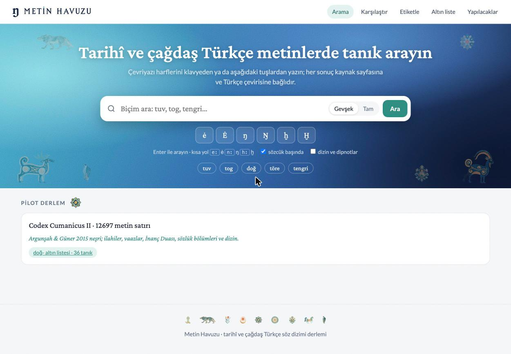
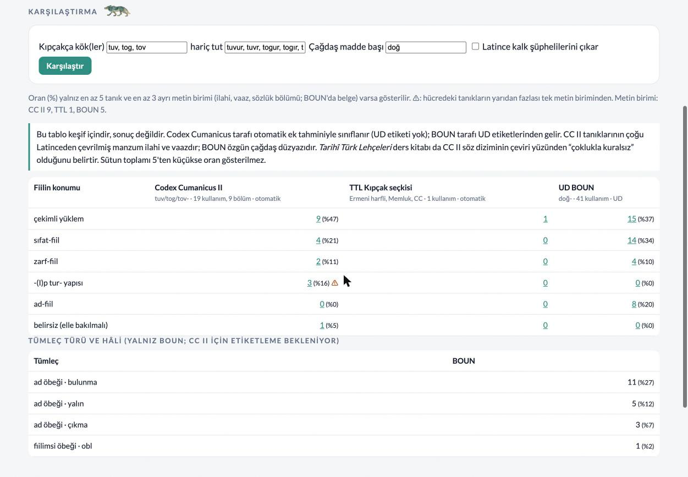
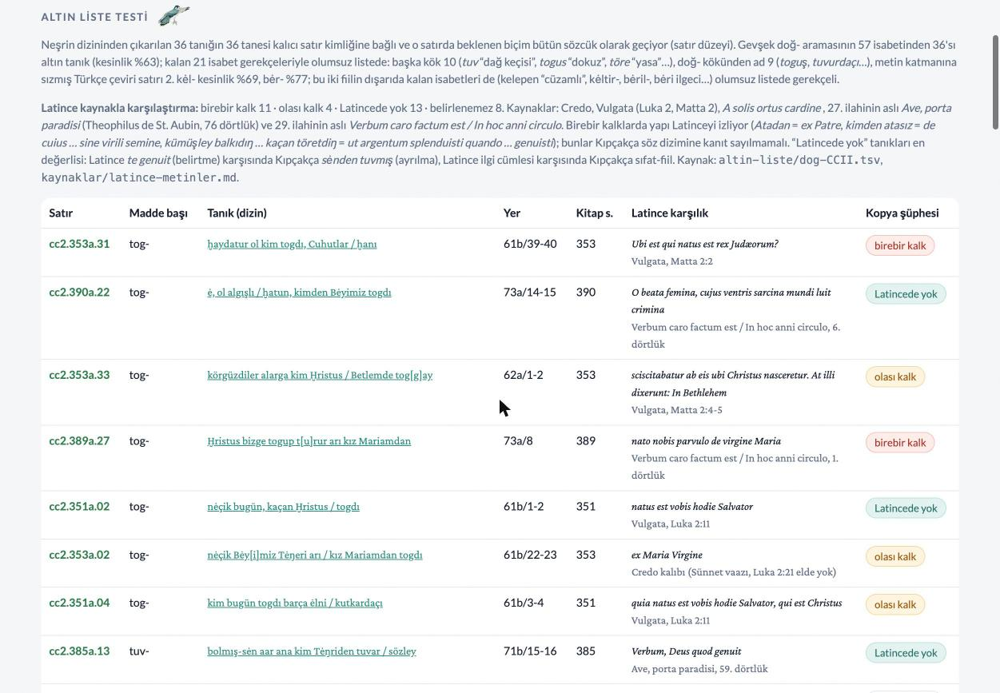
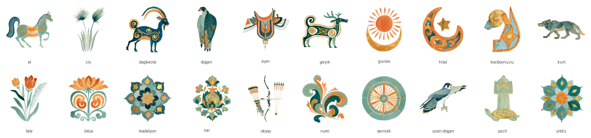

<p align="center">
  
</p>

<p align="center">
  <b>Tarihî ve çağdaş Türkçe metinlerde söz dizimi karşılaştırması için açık bir araştırma derlemi</b><br>
  <a href="https://metinhavuzu.com">metinhavuzu.com</a>
</p>

---

**Metin Havuzu**, 14. yüzyıl Kıpçak Türkçesi (Codex Cumanicus) ile çağdaş Türkiye Türkçesi arasındaki **söz dizimi** farklarını ölçülebilir biçimde karşılaştırmak için kurulmuş bir derlem ve web sitesidir. Her tanık kaynak sayfasına ve satırına bağlıdır; her karar yazılıdır; her otomatik işlem bir testle ölçülür.



## Ne yapar?

- **Transkripsiyon harfleriyle arama.** *ė, ŋ, ḫ* için sanal klavye; gevşek kipte *e = ė*, *n/ng = ŋ*, *h/x = ḫ*.
- **Kaynağa bağlı tanık sayfaları.** Her satırın kalıcı adresi (`#/tanik/cc2.394a.01`), yaprak ve neşir sayfası, Türkçe çevirisi ve çevirinin nasıl eşlendiği.
- **Madde başı araması.** *doğ-* yazınca Kıpçakça *tuv-, tog-, töre-* tanıklarının tamamı; tanık olmayan benzerler (ör. *tuv* “dağ keçisi”, *togus* “dokuz”) gerekçesiyle ayrı listede. CSV indirme ve makaleye hazır atıf.
- **Dönem karşılaştırması.** Aynı fiilin Codex Cumanicus, ders kitabı seçkisi ve UD Turkish BOUN'daki konumu (çekimli yüklem, sıfat-fiil, zarf-fiil, *-(I)p tur-*).
- **UD etiketleme.** Tarayıcıda Universal Dependencies etiketleme ekranı, sunucuda kalıcı kayıt, iki etiketleyici arasında uyuşma ölçümü (UAS, LAS, Cohen κ).



## Yöntem

| İlke | Uygulama |
| --- | --- |
| Söz dizimi, anlam değil | UD (Universal Dependencies), CoNLL-U; projeye özgü alanlar MISC sütununda (`YonetilenHal`, `YuzeyIsaret`, `Okuma`, `Periphrasis`) |
| Kararlar yazılı | [`kilavuz/KARARLAR.md`](kilavuz/KARARLAR.md): Kıpçakçaya özgü ya da BOUN'dan ayrılan her karar, gerçek bir tanık ve gerekçeyle |
| Ölçülebilirlik | Üç fiil için satır düzeyinde altın liste (doğ- 36, kėl- 37, bėr- 24 tanık; 97/97 bulunuyor), olumsuz listeler ve kesinlik; bozma denemesiyle sınanan testler |
| Kalıcılık | Her satırın dondurulmuş kalıcı kimliği; OCR düzeltmesinde değişmez ([`kimlik/`](kimlik/)) |
| Çeviri etkisinin denetimi | CC II'nin dinî metinleri Latinceden çeviridir: her altın tanık Latince aslına bağlı ve “kopya şüphesi” ile işaretli; karşılaştırmada kalk şüphelileri tek tıkla çıkarılır |
| Kümelenmeye karşı | Oran yalnız en az 5 tanık ve en az 3 ayrı metin biriminden geliyorsa gösterilir |



## İlk bulgular

Bunlar sonuç değil, yöntemin işlediğini gösteren ilk gözlemlerdir:

- *doğ-* tanıklarının bir bölümü Latinceyle birebir kalktır: *Atadan tuvup* = *ex Patre natum*, *Ataga tözdeş* = *consubstantialem Patri*.
- Kaynak Latincede belirtme, özne ya da ilgi hâlinde olsa bile Kıpçakça *doğ-*'un kaynağını **ayrılma hâliyle** verir (*Tėŋri sėnden kaçan tuvmış* ↔ *quando Christus te genuit*).
- *-(I)p tur-* yapısı *doğ-* tanıklarında yalnız Latince kalıplarda görülüyor; kalk şüphelileri çıkarılınca 3'ten 0'a düşüyor.
- *bėr-* “vermek” tanıklarının çoğunda Latincede “vermek” fiili yok; yönelme hâlli alıcı Kıpçakçanın kendi seçimi.
- Codex Cumanicus'taki bilmeceler çeviri değil, özgün Kıpçakçadır; söz dizimi için en güvenilir tanıklardır.

## Kaynaklar

| Kaynak | Lisans | Bu depoda |
| --- | --- | --- |
| Codex Cumanicus II, Argunşah & Güner 2015 (Kesit) | Telifli, izinli kullanım | **Hayır** (ayrı, özel depoda) |
| *Tarihî Türk Lehçeleri* ders kitabı, Kıpçak bölümü | Telifli, izinli kullanım | **Hayır** |
| [UD Turkish BOUN](https://universaldependencies.org/treebanks/tr_boun/) | CC BY-SA 4.0 | Evet (`kaynaklar/ud-boun`) |
| UD Ottoman Turkish BOUN, UD Kazakh KTB | CC BY-SA 4.0 | Evet |
| Latince asıllar (Vulgata, Credo, *Ave, porta paradisi*, *In hoc anni circulo*, *A solis ortus cardine* …) | Kamu malı | Evet ([`kaynaklar/latince-metinler.md`](kaynaklar/latince-metinler.md)) |
| 1941 Türkçe İncil çevirisi (seçmeler) | Kamu malı | Evet |

Tam künyeler: [`kaynaklar/KAYNAKLAR.md`](kaynaklar/KAYNAKLAR.md).

> Telifli neşir metni, çeviriler ve tarama görüntüleri bu depoda yer almaz. Veri hazırlama betiği bu kaynaklara erişimi olanlar için çalışır; depo kodu, yöntemi ve açık lisanslı kaynakları paylaşır.

## Mimari

```
PDF (izinli neşir) ──► pilot/hazirla.py ──► veri.js (satırlar, katmanlar, kimlikler, altın listeler)
                                               │
GitHub ──► Coolify (Docker + nginx) ──► Cloudflare ──► tarayıcı: arama, tanık, karşılaştırma, etiketleme
                                               │
                                     /kayit/<ad>.conllu (parolalı, kalıcı birim)
```

- **Veri hazırlama:** Python (yalnız standart kütüphane) + Poppler (`pdftotext -bbox-layout`).
- **Site:** HTML, CSS ve çerçevesiz JavaScript; derleme adımı ve dış bağımlılık yok, sıkı içerik güvenlik politikası (CSP).
- **Yayın:** Docker içinde root olmayan nginx; Coolify ile otomatik yayın; Cloudflare üzerinden erişim, doğrudan sunucu erişimi kapalı.

## Depo yapısı

| Klasör | İçerik |
| --- | --- |
| `pilot/` | Site (HTML/CSS/JS), veri hazırlama betiği, yazı tipleri, motifler |
| `altin-liste/` | Altın listeler, olumsuz listeler, bağlama ve test betikleri |
| `etiketler/` | Ön etiketler (CoNLL-U) ve üretim betiği |
| `kilavuz/` | Etiketleme karar kaydı |
| `kimlik/` | Kalıcı kimlik kayıtları ve testleri |
| `kaynaklar/` | Açık lisanslı kaynaklar ve künyeler |
| `deploy/`, `Dockerfile` | Sunucu yapılandırması ve yayın notları |
| `ORKESTRATOR.md` | Projenin ana planı ve karar geçmişi |

## Testler

```bash
python3 kimlik/test_kimlik.py      # kalıcı kimlik: çakışma 0, nakarat, tek harf, araya ekleme
python3 altin-liste/test_altin.py  # altın liste: satır düzeyi bulma, kesinlik, açıklanmayan isabet 0
```

(Testler, telifli veriden üretilen `pilot/veri/veri.js` dosyasını gerektirir.)

## Görsel kimlik

Logo, transkripsiyon harfi **ŋ**'yi işaret olarak kullanır. Sitedeki motifler eski Türk bozkır sanatından esinlenmiştir.



## Nasıl yapıldı?

Proje baştan sona bir yapay zekâ kodlama ajanıyla, her aşamanın sonunda insan denetimiyle kuruldu. Öğrenciler ve aynı yolu izlemek isteyen araştırmacılar için yapılış aşamaları ayrı bir belgede: **[Yapılış aşamaları: model iş akışı](docs/yapilis-asamalari.md)**.

| Aşama | Ne yapılır | Kontrol noktası |
| --- | --- | --- |
| 0 · Hazırlık | Ana plan, çalışma kuralları, `.gitignore`, iki depo | Yetki sınırları onaylanır |
| 1 · Soru ve kapsam | Plan eleştirisi, pilot kararı | “Bitti” ölçütü yazılı |
| 2 · Kaynaklar ve telif | Lisanslı kaynak tablosu, izin mektubu | Yazılı izin gelmeden site kapalı |
| 3 · Teknik kararlar | Dil, mimari, “ne zaman değiştiririz” koşulu | Gerekçeli seçim |
| 4 · Veri ve ölçüm | Katmanlar, kalıcı kimlik, altın liste, kesinlik | Testler geçiyor, bozma denemesi yakalanıyor |
| 5 · Site ve tasarım | Arama, tanık sayfası, karşılaştırma, logo ve motifler | Bilmeyen biriyle senaryo denemesi |
| 6 · Yayın ve güvenlik | Docker + nginx, Coolify, Cloudflare, parolalı kayıt | Sınama tablosu: beklenen = gerçek |
| 7 · Karar kaydı ve hakem | Kararlar, iki dış model hakemi, Latince eşleme | Eleştirilerin kabul/ret tablosu |
| 8 · Etiketleme ve devir | Etiketleme ekranı, uyuşma ölçümü, Yapılacaklar | İnsan denetimi |

Belgenin sonunda, bu dokuz aşamayı tek komutta toplayan bir **ana istem (master prompt)** yer alır.

## Durum

Pilot aşaması: doğ-, kėl- ve bėr- fiilleri; 23 cümle ön etiketli, insan denetimi ve iki etiketleyiciyle uyuşma ölçümü sürüyor. Yazı tipleri Crimson Pro ve Lato (SIL Open Font License).

## Lisans

Kod [MIT Lisansı](LICENSE) ile paylaşılır. Kaynak veriler kendi lisanslarına tabidir (UD derlemleri CC BY-SA 4.0; Latince asıllar kamu malı); telifli neşir verisi bu depoda yoktur.

---

<p align="center">Tarık İsmet Alkan · <a href="https://metinhavuzu.com">metinhavuzu.com</a></p>
