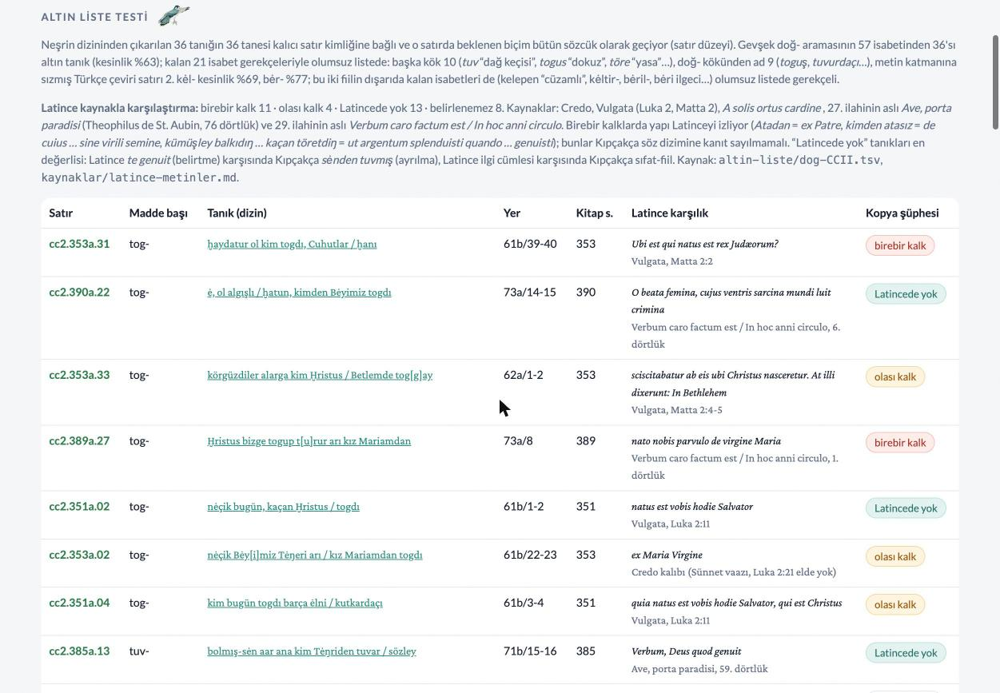
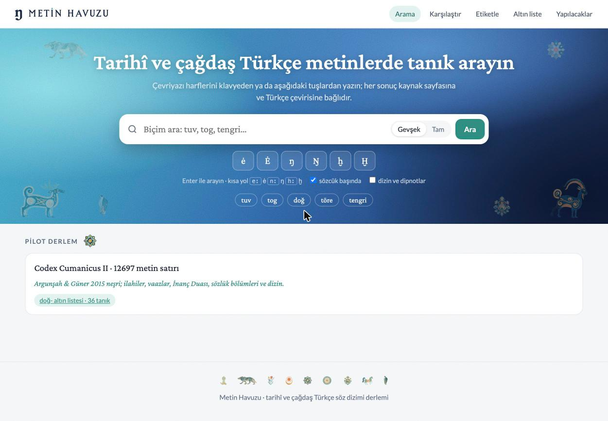
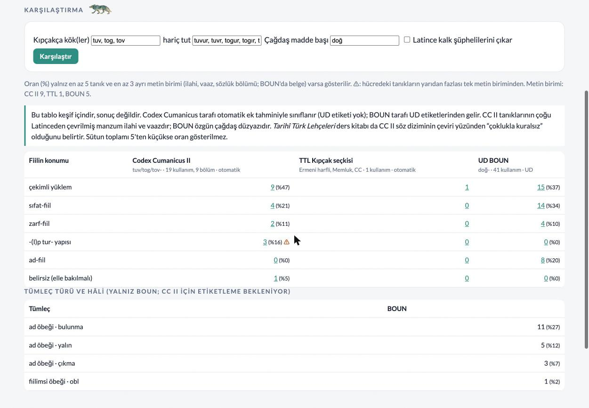
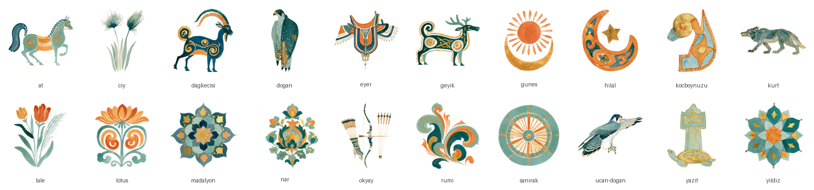
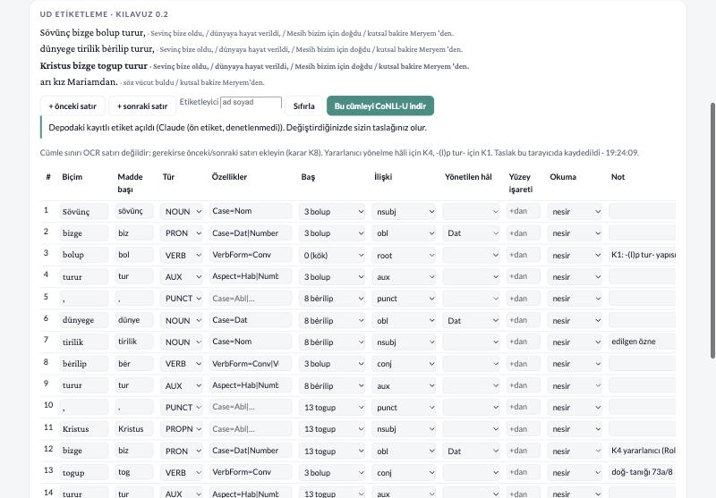

# Metin Havuzu: Yapay Zekâyla Bir Araştırma Derlemi Kurmak — Model İş Akışı

Tarık İsmet Alkan · Kasım 2026

## Bu belge nedir?

Bu belge, metinhavuzu.com araştırma derleminin bir yapay zekâ kodlama ajanıyla **en doğru biçimde nasıl kurulacağını** adım adım gösteren bir model iş akışıdır. Gerçek projede yaşanan her hata, tekrar ve dış hakem uyarısı burada önceden önlenmiş olarak kurgulanmıştır; istemler (komutlar) ders malzemesi olarak yeniden yazılmıştır.

**Kim için:** Yapay zekâ destekli dijital beşerî bilimler projesi kurmak isteyen öğrenciler ve araştırmacılar. Programlama bilgisi gerekmez; gereken, yapay zekâya ne istediğinizi, neyi kendinize saklı tuttuğunuzu ve başarıyı nasıl ölçeceğinizi açıkça söylemektir.

**Proje kısaca:** 14. yüzyıl Kıpçakçası (Codex Cumanicus) ile çağdaş Türkçe arasındaki sözdizimsel farkları karşılaştırmak için aranabilir, kaynak sayfasına bağlı, UD (Universal Dependencies) ile etiketlenebilen bir derlem ve web sitesi.

**Nasıl okunur:** Her aşama dört parçadan oluşur:

1. **Amaç:** Bu aşamada neyin bitmiş sayılacağı.
2. **İstem:** Yapay zekâya verilecek komut, olduğu gibi kopyalanabilir.
3. **Beklenen çıktı:** İyi bir yapay zekâ ajanının bu isteme yanıtı.
4. **Kontrol noktası:** İnsanın onaylamadan geçmemesi gereken şey.

Aşamalar, gerçek projede sırası yanlış kurulan işleri doğru sıraya koyar. Örneğin kalıcı kimlik, katman ayırma ve altın liste ölçümü burada site tasarımından önce gelir; telif ve güvenlik yayına almadan önce kararlaştırılır.

## Genel akış

```
0 Hazırlık → 1 Araştırma sorusu ve kapsam → 2 Kaynaklar, izin, telif → 3 Teknik kararlar
→ 4 Veri ve ölçüm → 5 Site ve tasarım → 6 Yayın ve güvenlik → 7 Karar kaydı, dış hakem, Latince
→ 8 Etiketleme, uyuşma, devir      (her aşamanın sonunda bir insan kontrol noktası)
```

Dokuz aşamanın her biri bir insan kontrolüyle kapanır. Veri ve ölçüm (Aşama 4), site yazılmadan önce gelir: gerçek projede sonradan düzeltilmek zorunda kalınan kalıcı kimlik, katman ayırma ve satır düzeyi altın test burada ilk günden kurulur.

## İyi istem yazmanın sekiz ilkesi

Bu belgedeki her istem aşağıdaki ilkelere göre yazılmıştır. Bir istemi göndermeden önce bu listeyi kontrol etmek, gereksiz turların çoğunu önler.

| İlke | Ne demek | Zayıf örnek | Güçlü örnek |
| --- | --- | --- | --- |
| 1. Amaç önce | İşin neye hizmet ettiğini söyle | “Bir arama sitesi yap.” | “Amacım sözdizimsel karşılaştırma; site bu amaca tanık bulmak için.” |
| 2. Kapsamı çiz | Neyin dışarda olduğunu da söyle | “Kıpçakçayı çözümle.” | “Anlam çözümlemesi yok; yalnız sözdizimi.” |
| 3. Bitti ölçütü ver | Başarının nasıl sınanacağını yaz | “Doğru çalışsın.” | “36 tanığın 36'sı satır düzeyinde bulunmalı.” |
| 4. Yetki sınırı koy | Neye kendisi karar verir, neyi sana sorar | “Sen hallet.” | “Kodu sen yaz; sunucu, telif ve parolayı bana sor.” |
| 5. Kaynak ve kısıt ver | Dosya yolu, izin, lisans | “Bu PDF'i kullan.” | “Yalnız s. 1–188 için izin var; herkese açık yayım izni yok.” |
| 6. Eleştiri iste | Onaylatma, sınat | “Planım iyi mi?” | “Planın en zayıf 3 noktasını test önerisiyle yaz.” |
| 7. Somut geri bildirim | Beğenmediğin şeyin nedenini söyle | “Güzel olmadı.” | “Harfler ince; tarihî yazıt havası yok; 2 seçenek göster.” |
| 8. Kayıt tuttur | Her karar bir dosyaya yazılsın | (yok) | “Kararı ve gerekçesini KARARLAR.md'ye ekle.” |

**Üç altın kural daha:**

- **Gizli bilgi istemde olmaz.** Parola, API anahtarı, token sohbete yazılmaz; kendi bilgisayarınızdaki bir dosyada durur, panellere siz girersiniz.
- **Yapay zekâ kendi işini denetleyemez.** Her önemli çıktı bir testle, bir insanın gözüyle ya da başka bir modelin eleştirisiyle sınanır.
- **Uydurma yasaktır.** İstemde açıkça söyleyin: “Bilmediğin bir kaynağı, numarayı ya da sayfayı uydurma; ‘belirlenemedi’ yaz.”

## Aşama 0 · Hazırlık: yapay zekâya çalışma koşullarını vermek

**Amaç.** Daha tek satır kod yazılmadan proje klasöründe üç şey hazır olur: projenin ana planı (ORKESTRATOR.md), çalışma kuralları ve gizli bilgilerin nerede durduğu.

**İnsanın önceden yapacağı.**

- Proje klasörünü ve özel bir GitHub deposunu açmak.
- İzin belgelerini toplamak: neşrin hangi sayfaları için, hangi kullanım (iç araştırma mı, herkese açık yayım mı) için izin var?
- Parolaları ve erişim anahtarlarını projenin dışında, kendi bilgisayarındaki bir dosyada tutmak.

**İstem.**

```text
Bu klasörde tarihî Kıpçakça ile çağdaş Türkçeyi sözdizimsel olarak karşılaştıracak bir araştırma derlemi kuracağız.
Başlamadan önce üç dosya oluştur:
1. ORKESTRATOR.md: amaç, kapsam, veri sözleşmesi, yöntem, açık sorular. Her önemli kararı tarihiyle buraya yazacaksın.
2. CLAUDE.md: çalışma kuralların:
   - Kodu ve teknik kararları sen verirsin; sunucu, telif, yayım, parola ve geri alınamaz işlemler için bana sorarsın.
   - Parola, token ya da anahtarı sohbete, koda veya git'e asla yazmazsın.
   - Bilmediğin kaynak, sayfa ya da sayıyı uydurmazsın; “belirlenemedi” yazarsın.
   - Her değişiklikten sonra testleri çalıştırır, sonucu bana söylersin.
3. .gitignore: telifli veri, gizli dosyalar ve geçici çıktılar depoya girmesin.
Dosyaları yaz, sonra bana özetle ve eksik gördüğün soruları sor.
```

**Beklenen çıktı.** Üç dosya ve yapay zekânın sorduğu birkaç netleştirme sorusu (örneğin “izin herkese açık yayımı kapsıyor mu?”).

**Kontrol noktası.** CLAUDE.md'deki yetki sınırlarını siz okuyup onaylayın. Bu sınırlar projenin geri kalanında “bunu bana sormalıydın” anını ortadan kaldırır.

## Aşama 1 · Araştırma sorusu ve kapsam

**Amaç.** Projenin ne ölçeceği tek cümleyle yazılır; pilot kapsam (metin, fiil, etiketleme biçimi) ve bu kurulumla **söylenemeyecek** şeyler baştan netleşir.

**İstem 1: önce eleştiri.**

```text
ORKESTRATOR.md'deki planı bağımsız bir hakem gibi eleştir. Onaylama, sına.
Amacım anlam değil, sözdizimi: tarihî ve çağdaş metinlerde aynı fiilin hangi hâllerle, hangi konumda (çekimli yüklem, sıfat-fiil, zarf-fiil) ve hangi tümleçlerle kullanıldığını karşılaştırmak.
Beş başlıkta yaz: araştırma tasarımı, etiketleme standardı, veri modeli, ölçüm, risk.
Her başlıkta en zayıf noktayı “sorun / neden önemli / öneri / nasıl sınanır” biçiminde ver.
Özellikle şunu cevapla: bu kurulumla bulunacak bir fark dönemden mi, lehçe kolundan mı (Oğuz/Kıpçak), yoksa Latinceden çeviriden mi gelir; bunları nasıl ayırabiliriz?
```

**Beklenen çıktı.** UD'nin (Universal Dependencies) neden uygun standart olduğu; çeviri etkisi, metin birimi yığılması ve tek neşre bağımlılık gibi riskler ve her biri için bir ölçüm.

**İstem 2: pilot kararı.**

```text
Pilotu şöyle sınırlayalım:
- Metin: Codex Cumanicus II (Argunşah & Güner 2015 neşri, izinli 188 sayfa).
- Fiiller: doğ- (tuv-/tog-/töre-) ve karşılaştırma için bėr- “vermek”. bėr-'in seçilme nedeni: çift tümleçli ve hâl seçimi zengin.
- Etiketleme: UD, CoNLL-U; etiketlemeyi ekip yapacak, sen öneri üretebilirsin ama önerin uyuşma ölçümüne girmeyecek.
- Çağdaş taraf: UD Turkish BOUN.
Bu kararı ORKESTRATOR.md'ye gerekçesiyle yaz ve pilotun “bitti” ölçütünü öner.
```

**Kontrol noktası.** Araştırma sorusu ve “bitti” ölçütü sizin cümlelerinizle ORKESTRATOR.md'de yazılı olmalı. Gerçek projede en verimli komutlar bu yön verici cümlelerdi; yapay zekâ ayrıntıyı doldurabilir, yönü belirleyemez.

## Aşama 2 · Kaynaklar, izin ve telif

**Amaç.** Her kaynağın lisansı ve saklanacağı yer baştan bellidir. Telifli veri ilk günden ayrı bir özel depoda durur; böylece kod deposu ileride güvenle açılabilir.

**İstem.**

```text
Kaynak envanteri çıkar ve kaynaklar/KAYNAKLAR.md'ye yaz. Her kaynak için: künye, içerik, boyut, lisans, nerede saklanacağı.
Elimdekiler:
- Argunşah & Güner 2015, Codex Cumanicus (Kesit). İzin yalnız s. 1–188 için, iç araştırma amaçlı. Dosya: <yol>.
- Tarihî Türk Lehçeleri ders kitabının Kıpçak bölümü; hocanın izniyle, yalnız proje içi. Dosya: <yol>.
Senden istediklerim:
1. Kamu malı ve açık lisanslı karşılaştırma kaynaklarını resmî adreslerinden indir: UD Turkish BOUN, metinlerin Latince asılları (Vulgata, litürjik metinler, ilahilerin asılları), Kuun 1880 neşri. Telifli bir kitabı üçüncü taraf sitelerden indirme.
2. İki depo kur: kod deposu ve telifli veri için ayrı özel bir veri deposu; veriyi koda alt modül (submodule) olarak bağla.
3. Telifli içeriğin hangi katmanının (metin, çeviri, dizin, tarama görüntüsü) sitede herkese açık gösterilebileceği konusunda belirsiz kalan noktaları bana soru olarak yaz; yayınevine sorulacak bir mektup taslağı hazırla.
```

**Beklenen çıktı.** Lisanslı bir kaynak tablosu, iki depo ve yayınevine gönderilecek izin mektubu taslağı.

**Kontrol noktası.** Yayınevinden yazılı yanıt gelmeden site herkese açılmaz; o zamana kadar parolalı kalır. Herkese açma kararı her zaman insanındır.

## Aşama 3 · Teknik kararlar ve mimari

**Amaç.** Programlama dili, site mimarisi ve barındırma düzeni gerekçeli olarak seçilir ve kayda geçer.

**İstem.**

```text
Teknik mimariyi öner ve gerekçelendir. Kısıtlar:
- Veri küçük (yaklaşık 15 bin satır, birkaç MB) ama veri modeli pilotta sık değişecek.
- Bakımı programcı olmayan dilbilimciler devralacak.
- UD araçlarıyla (doğrulayıcı, UDPipe, Stanza) uyumlu olmalı.
- Site hızlı, dış kütüphanesiz ve sıkı güvenlik politikasına (CSP) uygun olmalı.
Rust, Django/PostgreSQL ve hazır etiketleme araçlarını da değerlendir; şimdi seçmediklerini neden seçmediğini ve hangi koşulda seçeceğimizi yaz.
Kararı ORKESTRATOR.md'ye ekle.
```

**Beklenen çıktı.** Önerilen ve gerekçesi yazılı mimari:

| Katman | Seçim | Gerekçe |
| --- | --- | --- |
| Veri hazırlama | Python, yalnız standart kütüphane + Poppler (pdftotext) | Değişiklik dakikalar sürer; UD araçları Python'da |
| Site | HTML, CSS, çerçevesiz JavaScript | Derleme adımı ve bağımlılık yok; dilbilimci okuyabilir |
| Veri taşıma | Tek seferlik JSON (veri.js), aramalar tarayıcıda | 15 bin satırda milisaniyeler |
| Sunucu | Docker içinde nginx (root olmayan) | Yalnız dosya sunar ve etiket kaydı saklar |
| Yayın | GitHub → Coolify (Hetzner sunucusu) → Cloudflare | Her gönderimde otomatik, kesintisiz yayın |

Rust ancak derlem milyonlarca sözcüğe çıkarsa ya da arama sunucu tarafına taşınırsa (telifli metnin tarayıcıya toplu gönderilmemesi için) yeniden değerlendirilir.

**Kontrol noktası.** “Ne zaman değiştiririz?” sorusunun cevabı yazılı olmalı. Bu, ileride aynı tartışmanın tekrar açılmasını önler.

## Aşama 4 · Veri boru hattı ve ölçüm

**Amaç.** OCR metni satır satır, katmanlarına ayrılmış, kalıcı kimlikli ve ölçülmüş bir veriye dönüşür. Site yazılmadan önce verinin güvenilirliği sayıyla bilinir.

**İstem 1: veri ve kimlik.**

```text
PDF'ten satırları koordinatlarıyla çıkaran bir veri hazırlama betiği yaz (pdftotext -bbox-layout).
Gereksinimler:
- Her satır bir katmana ayrılsın: Kıpçakça metin, Türkçe çeviri, dizin, dipnot, editör notu. Her katmanın satır sayısını raporla; bir örneklemi bana göster.
- Her satıra kalıcı bir kimlik ver (derlem.sayfa+sütun.sıra, örn. cc2.394a.01). Kimlik ilk üretimde bir kayıt dosyasında dondurulsun; OCR düzeltmesinde ve araya satır eklendiğinde değişmesin. Aynı sayfadaki tekrar eden satırlar ayrı kimlik alsın.
- OCR düzeltmeleri metne doğrudan değil, gerekçeli ayrı bir düzeltme dosyasına yazılsın.
- Türkçe çeviriyi tanığa bağla ve her bağın türünü yaz (yan sütun, sözlük karşılığı, paragraf sırası); doğrulanmamış bağları işaretle.
Kimlik için test yaz: çakışma sıfır; tek harf düzeltmesi, tekrar eden satır ve araya satır ekleme senaryoları geçmeli.
```

**İstem 2: altın liste ve kesinlik.**

```text
Neşrin dizininden doğ- ve bėr- için altın liste çıkar. Her tanığı kalıcı satır kimliğine ve tam sözcük biçimine bağla (sayfa düzeyi yetmez).
Test yaz:
- Duyarlılık: her altın tanık kendi satırında bulunmalı.
- Kesinlik: gevşek aramada gelen her isabet ya altın tanık ya da gerekçeli bir “olumsuz liste” kaydı olmalı; açıklanmayan isabet kalmamalı.
- Bozma denemesi: bir tanığı bilerek boz ve testin yakaladığını göster.
Dizinde olmayıp metinde olan tanıkları ayrıca raporla.
```

**Beklenen çıktı.** Gerçek projedeki sayılarla: 14.411 satır; metin, çeviri ve dizin katmanları ayrı; altın listelerde 97/97 satır düzeyinde bulma; gevşek arama kesinliği doğ- %63, bėr- %77; dizinin kaçırdığı 1 tanık.



*Şekil 1. Bu aşamanın sonucu sitede: her altın tanık kalıcı satır kimliğine bağlı, yanında Latince karşılığı ve kopya şüphesi (Aşama 7).*

**Kontrol noktası.** Katman örneklemine siz bakın. Gerçek projede metin katmanının %12'sinin aslında Türkçe çeviri olduğu geç fark edildi; bu kontrol onu ilk gün yakalar.

## Aşama 5 · Arama sitesi ve tasarım

**Amaç.** Bir Türkoloğun yardım almadan kullanabileceği bir site: transkripsiyon harfleriyle arama, her sonuç için kaynak sayfası ve çeviri, kalıcı bağlantı, karşılaştırma ekranı.

**İstem 1: işlev.**

```text
Sitenin ilk sürümünü yaz. Kullanıcı senaryosu: bir Türkolog “tuvgan” yazar, 10 saniyede tanığı, çevirisini ve neşrin taranmış sayfasını görür; bağlantıyı makalesine koyabilir.
Gereksinimler:
- ė, ŋ, ḫ için sanal klavye ve iki arama kipi: gevşek (e=ė, n/ng=ŋ, h/x=ḫ) ve tam.
- Her tanığın kalıcı adresi (#/tanik/<kimlik>), yaprak, kitap sayfası, çevirisi ve bağ türü görünsün.
- Karşılaştırma ekranı: oran yalnız en az 5 tanık ve en az 3 ayrı metin birimi varsa gösterilsin; tek metne yığılmayı uyarıyla işaretle; “bu tablo keşif içindir” notu dursun.
Bitince siteyi kendi tarayıcında aç, senaryoyu dene ve ekran görüntüsüyle göster.
```

**İstem 2: tasarım (somut ve ölçülü).**

```text
Tasarım: açık, ferah, tipografik. Örnek aldığım site: <adres>; ondan düzeni al, renkleri alma.
- Yazı tipi: başlıkta tarihî havalı bir serif, metinde okunaklı bir sans-serif. İkisi de açık lisanslı olsun ve ė/ŋ/ḫ harflerini çizsin; sitenin kendi sunucusundan yüklensin.
- Logo: ŋ harfini işaret olarak kullanan, yazıt esinli bir yazı. 3 seçenek göster; her birinin neyi simgelediğini bir cümleyle yaz.
- Motifler (Midjourney): eski Türk bozkır sanatı esinli, her motif ayrı görselde, beyaz zeminde, kenarlardan uzak. Kestikten sonra hiçbirinin kenara değmediğini otomatik denetle.
```

**Beklenen çıktı.** Çalışan site ve ekran görüntüleri; logo için seçenekler. Gerçek projede logo üç, motifler dört turda kabul edildi; ölçütü baştan veren bir istem bu turları bire ya da ikiye indirir.



*Şekil 2. Ana sayfa: sanal klavye, arama kipleri, motifler.*



*Şekil 3. Karşılaştırma ekranı: oran kuralı ve tek metne yığılma uyarısı (⚠).*


*Şekil 4. ŋ işaretini kullanan, yazıt esinli logo.*



*Şekil 5. Midjourney ile üretilip otomatik kesilen 20 motif; hiçbiri kenara değmiyor.*

**Kontrol noktası.** Senaryoyu kendiniz deneyin: “tuvgan” aramasından tanığın taranmış sayfasına kaç tıklamada ulaştınız?

## Aşama 6 · Yayın ve güvenlik

**Amaç.** Site güvenli biçimde yayına çıkar: otomatik yayın, HTTPS, güvenlik başlıkları, telifli içeriğin önbellekte birikmemesi, sunucuya yalnız Cloudflare üzerinden erişim ve kalıcı etiket kaydı. Hepsi ilk yayında hazırdır, sonradan eklenmez.

**İnsanın önceden yapacağı.** Alan adını Cloudflare'e bağlamak; Coolify'ı kurmak ya da var olan panelde bir proje açmak; kullanılacak sunucuyu seçmek. Parolaları ve gizli anahtarları kendi bilgisayarında üretmek (örn. `openssl rand -hex 24`).

**İstem.**

```text
Siteyi yayına hazırla. Hedef: GitHub → Coolify (Hetzner sunucusu, adı: <sunucu>) → Cloudflare, alan adı <alan adı>.
Gereksinimler:
- Docker: root olmayan nginx, sağlık adresi, CSP/HSTS/nosniff/Referrer-Policy/Permissions-Policy başlıkları.
- Telifli içerik Cloudflare önbelleğine girmesin (Cache-Control: private).
- Sunucuya yalnız Cloudflare üzerinden ulaşılsın: Cloudflare'in eklediği gizli bir başlığı taşımayan istek 403 alsın. Değer verilmezse denetim kapalı kalsın ki site kilitlenmesin.
- Etiket kaydı: /kayit/<ad>.conllu, yalnız parolayla yazılsın, silme kapalı, kalıcı birimde (/srv/kayit) dursun.
- Parola ve gizli değerler yalnız Coolify ortam değişkenlerinde; derleme sırasında kullanılamaz olsun.
Yayından önce tüm ayarları yerel bir nginx'te gerçek yapılandırmayla sına; her güvenlik önlemini curl ile göster (beklenen ve gerçek durum kodu).
Panellerde değer alanları dışındaki her şeyi sen doldur; parola ve anahtar alanlarını boş bırak, ben gireceğim.
Yayından sonra canlı siteyi dışarıdan yeniden sına ve kalıcı birimin yeni yayında silinmediğini kanıtla.
```

**Beklenen çıktı.** Bir sınama tablosu: parolasız kayıt 401, doğrudan IP 403, Cloudflare önbelleği BYPASS, 4 MB üstü dosya 413, silme 403, yeniden yayından sonra kayıt yerinde. Gerçek projede yerel sınama yayından önce üç hata yakaladı.

**Kontrol noktası.** Gizli değerleri siz girersiniz; yapay zekâ değerleri görmez ve yazmaz. Sınama tablosundaki her satır “beklenen = gerçek” olmadan yayın tamam sayılmaz.

## Aşama 7 · Karar kaydı, dış hakem ve Latince eşleme

**Amaç.** Etiketleme başlamadan önce zor kararlar yazılır, plan başka modellere eleştirtilir ve çeviri etkisi ölçülebilir hale gelir.

**İstem 1: karar kaydı.**

```text
kilavuz/KARARLAR.md oluştur. Temel: UD Turkish BOUN kılavuzu. Yalnız Kıpçakçaya özgü ya da BOUN'dan ayrılan kararları yaz.
Her karar için: gerçek bir tanık (kalıcı kimliğiyle), seçenekler, seçilen çözüm, gerekçe, BOUN'dan sapma var mı.
BOUN'dan sapan bir kararı BOUN derleminin kendisinde nasıl uygulandığını sayarak göster ve aynı kuralın çağdaş tarafa da uygulanacağını yaz.
İlk adaylar: -(I)p tur- yapısı, ki/kim ile kurulan yan cümle, ilgeçler, ayrılma hâlli kaynak, yönelme hâlli yararlanıcı, cümle sınırı, editör ayraçları.
```

**İstem 2: dış hakem istemi.**

```text
Başka yapay zekâ modellerine vereceğim bir hakem istemi yaz (IKINCI-GORUS-PROMPT.md).
Hakemin bilmesi gerekenler: amaç, veri modeli, alınan kararlar ve ölçüm sonuçları (sayılarla).
Hakemden iste: yedi başlıkta eleştiri, her biri “sorun / neden önemli / öneri / test”; projenin şu anki durumunu varsaymasın, söylediklerini dosyadan doğrulasın.
Hakem yanıtları geldiğinde her eleştiriyi kabul/ret ve gerekçesiyle bir tabloya dök; kabul edilenleri öncelik sırasına koy.
```

**İstem 3: Latince eşleme.**

```text
CC II'nin dinî metinleri Latinceden çeviri. Her altın tanığa Latince karşılığını bağla ve dört değerli bir “kopya şüphesi” işareti koy: birebir kalk, olası kalk, Latincede yok, belirlenemez.
Kaynak: yalnız kamu malı metinler. Neşrin dipnotlarındaki kaynak bilgisini kullan (örn. ilahilerin yazarları). Aslı bulunamayan tanığa kaynak uydurma; “belirlenemez” yaz.
Karşılaştırma ekranına “Latince kalk şüphelilerini çıkar” anahtarı ekle ve sonucun değişip değişmediğini raporla.
```

**Beklenen çıktı.** Karar kaydı (sürüm 0.1), hakem istemi ve iki bağımsız hakem raporu; Latince eşlenmiş altın listeler. Gerçek projede bu adım iki ilahinin aslını buldurdu (*Ave, porta paradisi* ve *In hoc anni circulo*) ve ilk bulguyu verdi: doğ- tanıklarında *-(I)p tur-* yapısı kalklar çıkarılınca 3'ten 0'a düşüyor.

**Kontrol noktası.** Hakem eleştirilerinin hangilerinin uygulanacağına siz karar verirsiniz. Hakemler de yanılabilir; her ret gerekçesiyle yazılır.

## Aşama 8 · Etiketleme, uyuşma ve devir

**Amaç.** Ekip sitede etiketler, etiketler sunucuda kalıcı olarak saklanır, iki bağımsız etiketleyici arasındaki uyuşma ölçülür ve proje başkalarına devredilebilir hale gelir.

**İstem 1: etiketleme ekranı.**

```text
Siteye UD etiketleme ekranı ekle:
- Bir tanık açılınca cümle sözcüklere bölünsün; önceki/sonraki satır eklenebilsin (cümle sınırı OCR satırı değildir).
- Her sözcük için: madde başı, UPOS, özellikler, baş, ilişki, yönetilen hâl, yüzey işareti, okuma, not.
- Ağaç anında denetlensin (tek kök, döngü yok, her sözcüğün başı var).
- Kayıt: önce tarayıcıya, sonra etiketleyici adıyla sunucuya; iki bilgisayardaki kayıtlar cümle cümle birleşsin, daha yeni olan kalsın; günlük yedek alınsın.
- Uyuşma: sunucudaki iki etiketleyici seçilerek UAS, LAS ve alan alan Cohen kappa.
- Site herkese açık olacaksa yalnız kayıt parola istesin.
Ekranı iki etiketleyici adıyla uçtan uca sına: kayıt, başka tarayıcıdan geri çekme, uyuşma ölçümü.
```



*Şekil 6. Etiketleme ekranı: her sözcük için tür, özellikler, baş, ilişki, yönetilen hâl ve not.*

**İstem 2: ön etiket (yalnız öneri olarak).**

```text
Altın tanıkları içeren cümleleri UD ile ön etiketle.
Kurallar: etiketleyici alanına “ön etiket, denetlenmedi” yaz; emin olmadığın her kararı not sütununa gerekçesiyle yaz; her sözcük biçiminin kaynak satırda geçtiğini otomatik sına.
Cümle kimlikleri bir kez verildikten sonra değişmesin; yeni cümle eklerken eski kimliklerin aynı kaldığını sına.
Bu ön etiketler uyuşma ölçümüne girmeyecek: ikinci etiketleyici cümleleri bağımsız, sıfırdan etiketleyecek.
```

**İstem 3: devir.**

```text
Sitede bir “Yapılacaklar” sayfası oluştur: ekipteki bir etiketleyicinin başka bir şey okumadan ne yapacağını bileceği biçimde, her iş ilgili tanığa bağlantılı.
Sonra sürecin tamamını anlatan, ekran görüntülü bir rapor yaz: verilen kararlar, yapılan hatalar ve nasıl yakalandıkları, sınırlılıklar ve açık işler. Gizli bilgileri dışarıda bırak.
```

**Kontrol noktası.** Uyuşma sonuçları ve ön etiketlerin denetimi insan işidir. Bu ikisi tamamlanmadan etiketli veriyle dönem karşılaştırması yapılmaz.

## Kontrol listesi

Her aşamanın “bitti” sayılması için işaretlenmesi gerekenler:

- [ ] ORKESTRATOR.md, CLAUDE.md ve .gitignore yazıldı; yetki sınırları onaylandı
- [ ] Araştırma sorusu ve pilotun “bitti” ölçütü yazılı
- [ ] Kaynak tablosu lisanslarıyla hazır; telifli veri ayrı özel depoda
- [ ] Yayınevine izin mektubu gönderildi
- [ ] Mimari kararı ve “ne zaman değiştiririz” koşulu yazılı
- [ ] Katmanlar ayrı ve örneklemi insan tarafından denetlendi
- [ ] Kalıcı kimlik testleri geçiyor (çakışma 0)
- [ ] Altın listeler satır düzeyinde tam; açıklanmayan isabet 0; bozma denemesi yakalandı
- [ ] “tuvgan” senaryosu siteyi bilmeyen biri tarafından denendi
- [ ] Yayın sınama tablosunda her satır “beklenen = gerçek”
- [ ] Karar kaydı yazıldı; BOUN sapmaları gösterildi
- [ ] İki dış hakem raporu alındı; her eleştiri kabul/ret gerekçesiyle tabloda
- [ ] Altın tanıklar Latinceye eşlendi
- [ ] İki bağımsız etiketleyiciyle uyuşma ölçüldü
- [ ] Yapılacaklar sayfası ve süreç raporu hazır

**Kapanış.** Bu iş akışının özü iki ilkedir: **her şey ölçülsün** ve **her şey yazılsın**. Yapay zekâ hızlı ve yetkin bir yardımcıdır; ama yönü belirlemek, sonucu sınamak ve sorumluluğu almak araştırmacının işidir. Aşağıdaki ana istem, bu ilkeleri tek bir başlangıç komutunda toplar.

## Ana istem (master prompt)

Aşağıdaki metin, aynı yöntemle sıfırdan bir araştırma derlemi ve web sitesi kurmak isteyen herkes içindir. Bir yapay zekâ kodlama ajanına (örneğin Claude Code) boş bir proje klasöründe ilk mesaj olarak verilir. Köşeli ayraç içindeki yerler kendi projenize göre doldurulur. Hesapları olmayan kullanıcıyı ajan adım adım hesap açmaya yönlendirir; parola, doğrulama kodu ve ödeme bilgisini her zaman kullanıcı kendisi girer.

```text
Senin rolün: bu klasörde benimle birlikte bir araştırma derlemi ve web sitesi kuracak yazılım geliştirici, veri mühendisi ve araştırma asistanısın.

PROJE
- Araştırma sorusu: [örn. tarihî X ile çağdaş Y arasındaki sözdizimsel farklar].
- Kapsam dışı: [örn. anlam çözümlemesi].
- Kaynaklar ve izinler: [dosya yolları; hangi sayfalar, hangi kullanım için izin var].
- Pilot: [metin], [1–2 fiil ya da yapı], etiketleme standardı [örn. UD / CoNLL-U].
- Alan adı (varsa): [alan adı].

ÇALIŞMA KURALLARI
1. Önce yaz: ORKESTRATOR.md (amaç, kapsam, yöntem, kararlar), CLAUDE.md (bu kurallar), .gitignore. Her önemli kararı tarihi ve gerekçesiyle ORKESTRATOR.md'ye ekle.
2. Kodu ve teknik kararları sen verirsin. Şunlar için bana sorarsın: sunucu ve hizmet seçimi, telif ve herkese açık yayım, para harcanan her şey, geri alınamaz işlemler (silme, geçmişi yeniden yazma).
3. Gizli bilgi: parola, token, API anahtarı ya da doğrulama kodunu sohbete, koda, git'e veya ekran görüntüsüne yazmazsın ve hiçbir alana kendin girmezsin. Bunları ben kendi bilgisayarımda üretip panellere kendim girerim; sen diğer alanları doldurup değer alanını boş bırakırsın.
4. Uydurma yok: bilmediğin kaynak, sayfa, sayı ya da yazarı uydurmazsın; “belirlenemedi” yazarsın. Telifli eserleri yetkisiz kaynaklardan indirmezsin.
5. Ölç: her aşamada test yaz, testi bilerek bozup yakaladığını göster, sonucu sayıyla raporla. Sunucu ayarlarını yayından önce yerelde gerçek yapılandırmayla sına.
6. Her aşamanın sonunda dur: ne yaptığını, neyi doğruladığını, neyi doğrulayamadığını ve benim karar vermem gerekenleri kısaca yaz.

HESAPLAR
Başlamadan önce hangi hesaplarım olduğunu sor: GitHub, bir bulut sunucusu (örn. Hetzner), Coolify (kendi sunucuda yayın paneli), Cloudflare, varsa görsel üretim aracı.
Olmayan her hesap için beni adım adım yönlendir:
- Hesabın ne için gerektiğini, ücretsiz mi ücretli mi olduğunu ve yaklaşık aylık maliyetini söyle.
- Kayıt sayfasını aç; e-posta, parola, iki adımlı doğrulama ve ödeme bilgisini ben gireyim. Robot doğrulamasını ben çözeyim.
- Hesap açıldıktan sonra kurulumu (depo, sunucu, DNS, uygulama) sen yap; her adımda ne yaptığını söyle.
- Erişim anahtarı gerekiyorsa en dar yetkili olanı iste, nasıl oluşturacağımı tarif et; anahtarı ben bir dosyaya kaydedip sana yalnız dosya yolunu veririm.

AŞAMALAR (her biri bitmeden bir sonrakine geçme)
0. Hazırlık: üç dosya, iki özel depo (kod + telifli veri, veri alt modül olarak).
1. Eleştiri: planı bağımsız bir hakem gibi eleştir; farkların dönemden mi, lehçeden mi, çeviriden mi geldiğini nasıl ayıracağımızı yaz.
2. Kaynaklar: lisanslı kaynak tablosu; kamu malı karşılaştırma kaynaklarını resmî adreslerinden indir; yayınevine izin mektubu taslağı.
3. Mimari: dil ve mimari önerisi, seçilmeyen seçenekler ve “ne zaman değiştiririz” koşulu.
4. Veri ve ölçüm: koordinatlı satırlar, katmanlar (metin/çeviri/dizin/dipnot), dondurulmuş kalıcı kimlik, OCR düzeltme dosyası, satır düzeyi altın liste, olumsuz liste ve kesinlik.
5. Site: arama (gerekirse sanal klavye ve gevşek kip), tanık sayfası ve kalıcı adres, karşılaştırma ekranı (en az 5 tanık ve 3 metin birimi kuralı). Tasarım için bana somut seçenekler sun.
6. Yayın ve güvenlik: Docker + nginx, otomatik yayın, güvenlik başlıkları, önbellek, doğrudan IP engeli, kalıcı birim; yayından önce ve sonra sınama tablosu.
7. Kararlar ve hakem: karar kaydı (standarttan sapmalar gösterilerek), başka modeller için hakem istemi, gelen eleştirilerin kabul/ret tablosu, çeviri kaynağıyla eşleme.
8. Etiketleme ve devir: etiketleme ekranı ve sunucuda kayıt, uyuşma ölçümü, ön etiket (yalnız öneri olarak), Yapılacaklar sayfası, ekran görüntülü süreç raporu.

İLK İŞİN
Aşama 0'ı yap, ardından bana hesaplarımı ve projenin eksik bilgilerini sor. Sorularını numaralı ve tek mesajda yaz.
```

**Kullanırken dikkat.**

- Ajanın her aşamanın sonunda verdiği özeti okuyun; “doğrulayamadıklarım” listesi en önemli kısımdır.
- Ücretli hesaplar (sunucu, alan adı) için ajan size maliyeti söyler; onayı siz verirsiniz.
- Bu istem bir başlangıç noktasıdır. Projeniz ilerledikçe ORKESTRATOR.md ve CLAUDE.md asıl rehber haline gelir; konuşma uzadığında ajan bu dosyalardan devam eder.
